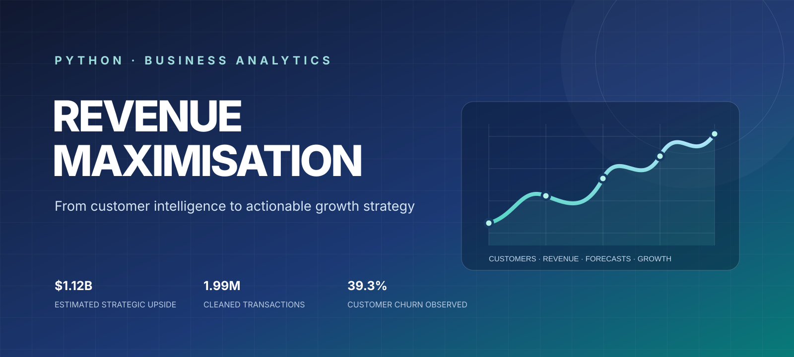

# Revenue Maximisation | Data-Driven Growth Strategy

**A Python-based commercial analytics project examining revenue decline, customer retention, product mix, regional performance and growth opportunities in a multinational consumables and instruments business.**

[Portfolio website](https://waliabidi2315.github.io/Revenue-Maximisation-on-Python/) · [Full PDF report](report/Revenue_Maximisation_Report_Group5.pdf) · [Analysis notebook](notebooks/revenue_maximisation_analysis.ipynb)

## At a glance

| Analysis | Reported result |
|---|---:|
| Cleaned transaction records | **1,988,532** |
| Total revenue in analysed data | **$7.39B** |
| FY2023 customers not reordered by FY2025 | **39.3%** |
| Historical revenue associated with churned customers | **$431.4M** |
| Estimated combined upside across seven strategies | **$1.12B** |

## Business problem

The project investigates a declining revenue trajectory in a multinational B2B consumables and instruments business. Using transaction data spanning FY2023 to FY2026 (with FY2026 partial), the team examines whether the decline is associated with customer churn, product mix, pricing, geography or seasonality, then translates the findings into a set of commercial actions.

## Analytical pipeline

1. **Prepare the data** — standardise fields and dates, correct fiscal-year assignments, aggregate duplicate order/SKU lines, and engineer unit-price and revenue-band features.
2. **Explore revenue** — analyse fiscal-year trends, monthly seasonality, regions and product classes.
3. **Diagnose customers** — use Pareto analysis, churn and cohort retention, and RFM segmentation with K-means.
4. **Assess the portfolio** — examine BCG division categories, SKU concentration, price–quantity patterns and cross-sell gaps.
5. **Forecast and size opportunities** — build a Prophet business-as-usual baseline and model seven proposed revenue strategies.

## Key findings reported by the project

- **Customer retention:** 6,620 of 16,825 FY2023 customers (39.3%) had not ordered by FY2025; historical revenue associated with those customers was reported as $431.4M.
- **Customer concentration:** 2,642 customers (8.6% of the base) accounted for 80% of revenue.
- **Cross-sell:** 15,862 accounts were identified as consumables-only. A 5% conversion scenario was estimated to yield $136.9M in incremental annual revenue.
- **Regional opportunity:** the report estimated $628.5M in upside from capturing 30% of the geographic performance gap.
- **Forecast:** the Prophet business-as-usual forecast projected FY2029 revenue at approximately $1.05B.

## Seven proposed strategies

| Strategy | Estimated upside |
|---|---:|
| Protect top 2,642 accounts | $129.67M |
| Re-engage churned customers | $86.27M |
| Cross-sell Instruments to Consumables-only accounts | $136.94M |
| Reallocate investment across BCG divisions | $3.78M |
| Prepare for seasonal demand peaks | $16.90M |
| Rationalise low-contribution SKUs | $116.49M |
| Improve underperforming regional performance | $628.50M |
| **Total estimated strategic upside** | **$1,118.55M** |

These values are estimates based on the report's assumptions and scenario modelling. They are not realised revenue, independently validated forecasts, or guaranteed outcomes.

## Tech Stack & Methods

**Python · pandas · NumPy · scikit-learn · Facebook Prophet · matplotlib · seaborn · PyArrow · Jupyter**

Methods include exploratory data analysis, log-log OLS regression, BCG portfolio analysis, SKU/customer Pareto analysis, RFM feature engineering and K-means clustering, cohort retention, Prophet time-series forecasting and scenario modelling.

## Project resources

- [Interactive-style project overview](https://waliabidi2315.github.io/Revenue-Maximisation-on-Python/)
- [Full original PDF report](report/Revenue_Maximisation_Report_Group5.pdf)
- [Detailed Jupyter notebook](notebooks/revenue_maximisation_analysis.ipynb)
- [Source figures](assets/)

## Reproducibility and limitations

The original notebook expects a course-provided Parquet input named `final_student_dataset.parquet` (approximately 49 MB), which is not included in this repository. The original report and notebook are retained, but the full analysis cannot be rerun from this repository alone without obtaining the dataset from an authorised source and placing it alongside the notebook as instructed in the notebook's data note.

The analysis covers approximately 3.3 fiscal years, with FY2026 partial through April 24, 2026. Revenue opportunity estimates depend on assumptions such as conversion rates, revenue multipliers and geographic gap capture. The forecast extrapolates a relatively short historical series and carries material uncertainty. The results should be interpreted as an academic business-analysis exercise, not operational advice or verified company performance.

## Team and project context

Group 5 — Arhant Doongarwal, Hriman Saha, Lakshita Purwar, Ravi Pratap Singh, Shreyit Sinha and Wali Abidi.

Introduction to Python Programming · Tata Institute of Social Sciences · May 4, 2026.

---

*This repository README is a concise project introduction. The full report remains available as a PDF and the detailed computational workflow remains in the notebook.*